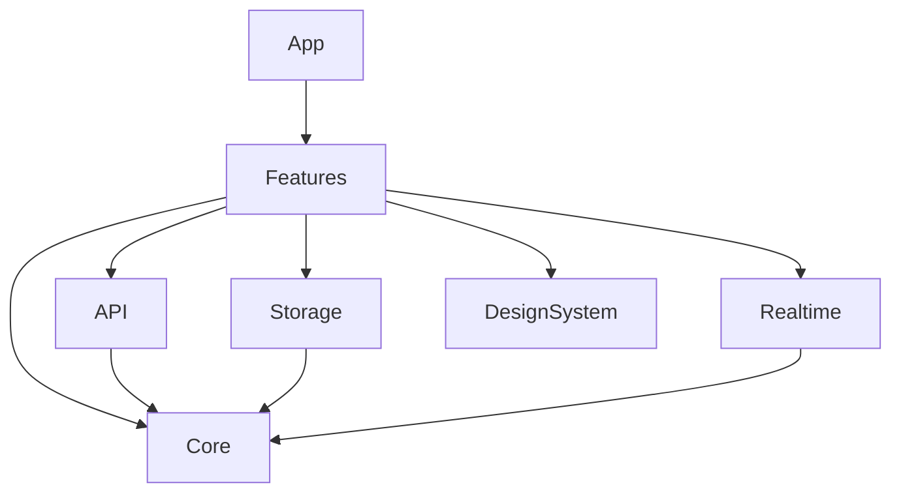

# Этап 02: архитектура

Срез: 2026-11-05. Приложение iPhone/iPad, iOS 18+, Swift 6, SwiftUI.
Репозиторий остаётся `janickiy/meetspace_ios_mobile`, как указано пользователем.
Backend, Android и прототип используются как источники; их код не изменён.

## Сборка и модули

`MeetSpace.xcodeproj` содержит приложение, hosted unit-тест Keychain и UI-тесты.
Общие схемы `MeetSpace-Debug` и `MeetSpace-Release`: соответствующая конфигурация запуска;
Test всегда Debug, Archive всегда Release. Deployment target 18.0, device family `1,2`.
Signing team выбирается локально для устройства. Simulator tests используют стандартную
ad-hoc подпись Xcode: она необходима hosted-приложению для доступа к Keychain.
Отдельная Release-проверка выполняет сборку без подписи.

Локальный Swift package не требует сторонних зависимостей. macOS 15 в package platforms
нужен только для проверки исходников на хосте; macOS-приложение не поставляется.

| Каталог / target | Ответственность |
| --- | --- |
| `App` | `@main`, сборка зависимостей, Info.plist, privacy manifest; DEBUG doubles для UI-тестов |
| `Core` / `MeetSpaceCore` | Проверенный origin, конфигурация, интерфейсы хранилищ, маршруты и состояния |
| `API` / `MeetSpaceAPI` | Единственная реализованная операция: публичный `GET /version` |
| `Realtime` / `MeetSpaceRealtime` | Сборка WSS URL по проверенным контрактам, интерфейс состояния; соединение не реализовано |
| `Storage` / `MeetSpaceStorage` | Keychain actor и actor публичных UserDefaults-настроек |
| `DesignSystem` / `MeetSpaceDesignSystem` | Светлая/тёмная палитра, Inter, геометрия бренд-знака, карточки, кнопки, русские строки |
| `Features` / `MeetSpaceFeatures` | Observable MainActor-модель, onboarding, независимые стеки вкладок, экраны, явное демо |
| `Tools/PreviewRenderer` | Только macOS: рендер через NSHostingView, без запуска iOS и без имитации iOS-проверок |

`AppDependencies` принимает `ServerProbing`, `ConfigurationStore`, `SecureStore`.
Тесты передают управляемые doubles; production composition использует URLSession,
PreferencesStore и KeychainStore. В DEBUG тестовые зависимости включаются только
явным `-uitesting`. В Release такого кода нет. Демо-просмотр доступен и в Release:
он соответствует ссылке «Посмотреть интерфейс» в исходном welcome, всегда имеет
баннер и не означает авторизацию. Тестовые launch arguments Release не обрабатывает.

## Сеть и собственный сервер

`ServerOrigin` принимает только HTTPS origin. Удаляются внешние пробелы и корневой `/`,
нормализуются регистр host и стандартный порт 443. Сохраняются нестандартные порты,
IPv6 и IDNA. HTTP, userinfo, query, fragment, подпути, percent-escapes, backslash,
внутренние пробелы, управляющие символы и недопустимые порты отклоняются.
Codable decoding проходит ту же валидацию. Это валидация адреса, не сертификата.

Проверка сервера обращается только к `https://origin/version`, без `/api/v1`, Bearer,
cookies и credential storage. Транспорт ephemeral; общий URL cache не используется.
Перенаправления не выполняются, включая переход на другой HTTPS origin. Ответ
ограничен 128 KiB, HTTP 200 и `application/json`; ожидаются строки `version`, `commit`,
`buildTime`. Таймаут запроса 15 секунд, ресурса 20 секунд. Завершение/ошибка чтения
отменяет task. Данные ответа и URL с секретами не логируются.

Проверка сертификата полностью остаётся системе: нет trust challenge override,
самоподписанных исключений и ATS exception domains. TLS-ошибка не переводит во вход.
Факт ответа `/version` не доказывает работоспособность авторизации или всех модулей;
это явно указано в интерфейсе.

Каждая проверка имеет поколение и cancellable Task. Изменение поля, новый запрос
или уход со страницы инвалидирует предыдущее поколение. Даже transport, игнорирующий
cancel, не может заменить новый результат старым. До успешной проверки вход недоступен.
После проверки сохраняется только public origin. Пароли формы остаются в памяти
View, не отправляются и сбрасываются при уходе. Вход/регистрация пока отключены.

WSS endpoints: `/api/v1/ws?ticket=...` и `/api/v1/conferences/{uuid}/ws?ticket=...`.
`URLQueryItem` кодирует билет; его не следует логировать вместе с URL.
Получение билета, event decoding, reconnect, WebRTC и фоновые задачи не реализованы.
Основание: [HTTP-контракт](API_CONTRACTS.md), [Realtime-контракт](REALTIME_PROTOCOL.md).

## Хранение

Конфигурация в `meetspace.configuration.v1` содержит только `server` и `appearance`.
Испорченная конфигурация не превращается в успешное подключение; показывается уведомление.
Последовательные изменения темы сохраняются в том же порядке.

`KeychainStore` реализует `SecureStore`: generic password, отдельный service,
account key = нормализованный origin + account UUID, `WhenUnlockedThisDeviceOnly`,
`Synchronizable=false`. Delete ограничен конкретным ключом. Нет общего wipe,
plaintext fallback и логирования. Токены ещё не создаются: интеграция auth — следующий этап.
Симуляторный hosted test проверяет read/update/delete и изоляцию двух серверов.
Он прошёл в GitHub Actions на iPhone SE (3rd generation) и iPad mini (A17 Pro),
iOS 18.5 / Xcode 16.4. Локально полный Xcode отсутствует.

Privacy manifest декларирует собственные UserDefaults (`CA92.1`), отсутствие tracking
и SDK-сбора данных на текущем этапе. Перед добавлением аналитики/медиа/новых SDK
manifest должен быть пересмотрен. См. [Apple: UserDefaults](https://developer.apple.com/documentation/foundation/userdefaults)
и [required reason API](https://developer.apple.com/documentation/bundleresources/app-privacy-configuration/nsprivacyaccessedapitypes/nsprivacyaccessedapitype).

## Навигация и доступность

Три вкладки: Встречи / Чаты / Профиль. У каждой свой `NavigationStack` и typed path.
Маршруты деталей несут идентификатор fixture; смена вкладки сохраняет глубину.
Выход из демо очищает все пути. Навигация авторизации не зависит от демо.

При ширине от 700 pt чат показывает список и диалог рядом; при меньшей — push-диалог.
Onboarding от 800 pt показывает боковую панель. Accessibility Dynamic Type переводит
эти экраны в одну колонку. Это решение для текущего этапа, а не доказательство полной
поддержки всех размеров iPad Split View. Multiwindow пока выключен.

Inter подключается через CoreText с `relativeTo` для Dynamic Type. Иконки-кнопки имеют
текстовые accessibility labels и цель 44 pt; аватары/декор исключены из VoiceOver.
Баннер демо и нижние вкладки растут до XXXL: ограничение относится только к постоянной
навигации, чтобы она не занимала весь экран при accessibility-размерах. Прокручиваемое
содержимое сохраняет системный размер текста. В accessibility-режиме выбор темы
переходит от компактного segmented control к вертикальным кнопкам с признаком выбора.
Проверка настоящим VoiceOver, keyboard navigation и accessibility inspector ещё нужна.

Loading/empty/error/offline/content общие для списков. В демо их можно переключать
из Профиля, retry возвращает fixture content. Это не индикатор реального сетевого
состояния авторизованного аккаунта. Экран подключения показывает реальные ошибки probe.
Поиск в демо локальный; он не выдаётся за серверный search endpoint.

## Что подключать следующим

Авторизация, сессии/refresh/logout, account lifecycle; затем repositories для
встреч/чатов/папок, подтверждённые права, realtime и медиа. SSH, CallKit, APNs,
ReplayKit и видеофайлы отсутствуют. Никаких новых backend endpoints не предложено.
Расшифровки, AI и message reactions не активированы: их контракт не подтверждён аудитом.
