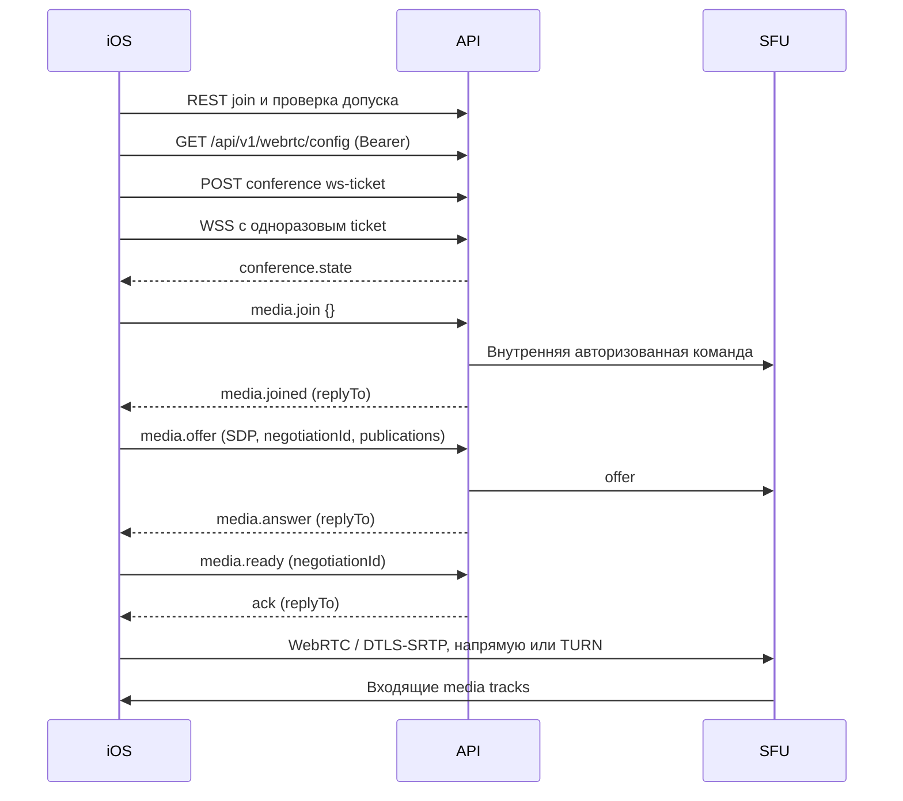

# Realtime, SFU и личные звонки

Дата: 2026-11-05. Источник — backend `56a0b0721806f7db5ad4e658c856ddfe8ebd6acd`
и Android `b8f289983e60671d415a128734c2e5bb6e93a29d`.
Это контракт по коду; реальные звонки на iPhone/iPad пока **BLOCKED / не проверены**.

## Три разных канала

| Канал | Подключение | Назначение |
| --- | --- | --- |
| Conference WebSocket | `POST /api/v1/conferences/:id/ws-ticket` с Bearer; затем `wss://origin/api/v1/conferences/:id/ws?ticket=...` | Участники, модерация, conference chat, сигнализация медиа |
| User WebSocket | `POST /api/v1/ws-ticket` с Bearer; затем `wss://origin/api/v1/ws?ticket=...` | Личные/групповые чаты, папки, звонки, аккаунтные события |
| Notifications SSE | `GET https://origin/api/v1/notifications/events` с Bearer | `notification.created`, `notification.read`; не медиа и не VoIP push |

Источники: [conference handler][B-ws], [user handler][B-user-ws], [SSE][B-sse].
User WS — серверный поток: клиентские команды чата/звонков выполняются по HTTP.
У конференционного WS есть `go-recorder.v1` subprotocol; Android отправляет его.
У user WS этот subprotocol не заявлен. [Android transport][A-api]

Билет: HTTP 201, **без status wrapper**, `{ticket,expiresAt}`; случайный одноразовый
секрет, область conference ID или `global`, TTL по умолчанию 45 секунд, настраивается.
Повторное соединение требует нового билета. Query и билеты не логировать.

Conference WS также принимает Bearer при отсутствии ticket. User WS требует ровно
один query `ticket`, без Authorization. Не совмещать ticket и Bearer.
Для direct call билет конференции запрашивается с `{clientId}`: сервер проверяет
владельца медиа. Использование только Bearer не заменяет привязку clientId.
Пустой Origin разрешён нативному клиенту; непустой проверяется по allowlist/same-host.

## Envelope и первичное состояние

Подтверждённая форма [Envelope][B-envelope]:

```json
{
  "version": 1,
  "id": "00000000-0000-4000-8000-000000000001",
  "type": "media.join",
  "conferenceId": "00000000-0000-4000-8000-000000000002",
  "timestamp": "2026-11-05T09:00:00Z",
  "data": {}
}
```

Идентификаторы и timestamp здесь синтетические, это не захваченная production-сессия.
`replyTo` присутствует у ответа на команду; **не отправлять его в клиентском request**.
Сервер проверяет version=1, непустой UUID, conferenceId, timestamp, UTF-8 и JSON.
Клиент не задаёт доверенные user/participant/session IDs. [Декодирование][B-ws-messages]

Первый `conference.state` содержит `connectionId,participantId,status,participants`.
У presence есть `online,connections,connectionIds` плюс ParticipantView.
Членство и физическое подключение различны: reconnect меняет connectionId.
[Hub][B-hub] формирует видимость состояния по текущему допуску.
В account-событиях conferenceId может быть пустой строкой.

## SFU: подтверждённая последовательность



Media API [controller][B-media] использует существующий SFU; не подключаться напрямую
к закрытым `/internal/media/*`. TURN_SHARED_SECRET и MEDIA_INTERNAL_SECRET — только серверные.
Медиапоток не проходит через REST, RabbitMQ или хранилище сообщений.

| Клиент → сервер | Поля `data` | Подтверждение |
| --- | --- | --- |
| `media.join` | `{}` | `media.joined` |
| `media.offer` | `mediaPeerId,negotiationId,sdp,publications?` | `media.answer` с тем же negotiationId |
| `media.ready` | `mediaPeerId,negotiationId` | `ack`, `data.type=media.ready` |
| `media.ice` | `mediaPeerId,candidate` | `ack`; candidate object либо JSON null |
| `media.unpublish` | `mediaPeerId,trackId` | `ack`; lifecycle трека отдельно |
| `media.leave` | `mediaPeerId` либо `{}` для отмены ещё незавершённого join | `media.left` |

Publication: `mid,source,trackId?`; максимум 4 уникальных источника и MID.
Sources: `microphone`, `camera`, `video/screen`, `audio/screen`.
`trackId` публикации — идентификатор поколения локального захвата; не путать
с серверным UUID track. [Media DTO][B-media-model]

`media.joined` фактически выдаёт `mediaPeerId,workerId,maxPeers,iceServers,tracks,
videoCapture,policy`. В текущем controller отсутствуют `iceTransportPolicy` и
`iceExpiresAt` в этом ответе, хотя они существуют во внутреннем Result.
Получать relay policy/срок TURN из **GET /webrtc/config** (`iceServers,
iceTransportPolicy?,expiresAt?`, expiry — Unix seconds), как делает
[Android engine][A-engine]. Не потерять принудительный TURN relay.

Серверные media events:

| Событие | Данные / реакция клиента |
| --- | --- |
| `media.answer` | `mediaPeerId,negotiationId,sdp`; применить remote SDP до ready |
| `media.ice` | `mediaPeerId,candidate`; ставить в очередь до remote description |
| `media.tracks` | `mediaPeerId,revision,tracks`; каталог доступных tracks |
| `media.renegotiate` | `mediaPeerId,revision`; объединить изменения и создать новый offer |
| `media.published` | `mediaPeerId,track` |
| `media.unpublished` | `mediaPeerId,trackId` |
| `media.policy` | `mediaPeerId,policy`; применить только актуальную версию |
| `media.state` | `mediaPeerId,state`; failed/closed требуют восстановления |
| `media.error` | `mediaPeerId,code`, например unsupported_codec_or_simulcast |
| `media.left` | `mediaPeerId`; завершение данного media peer |
| `ack` / `error` | Корреляция через replyTo; error содержит `data.code` |

Источники: [SFU peer][B-sfu-peer], [tracks][B-sfu-tracks], [policy][B-sfu-policy],
[controller][B-media]. Opus и VP8 подтверждены [SFU manager][B-sfu-manager].
H.264 и simulcast не считать поддержанными по общим возможностям выбранного iOS SDK.
Ограничения: SDP media до 128 KiB, ICE до 4096 байт; фактические transport limits
и server `videoCapture/maxPeers` важнее произвольных локальных значений.

Политика `version,microphoneBlocked,cameraBlocked,screenBlocked,kicked` применяется
на сервере. `video/screen` блокируется screen или camera policy; `audio/screen`
также microphone policy. Разблокирование не является согласием пользователя
автоматически включить микрофон/камеру.

В старом протоколе ещё принимаются `webrtc.offer/answer/ice` с targetConnectionId;
это отдельный legacy relay [messages][B-ws-messages]. iOS SFU не должен смешивать
его с `media.*` или трактовать его как единственную современную сигнализацию.

## События продукта и восстановление

| Семейство | Подтверждение | Что восстанавливать после разрыва |
| --- | --- | --- |
| `conference.state`, `participant.connected/disconnected` | [hub][B-hub] | Conference, self participant, presence |
| `participant.admitted/rejected`, `participant.media.updated/role.updated/kicked` | [admission][B-admission-events], [control][B-control-events] | Допуск и политика; kicked останавливает медиа |
| `chat.message.created/updated/deleted`, `chat.read.updated` | [chat service][B-chat-service] | HTTP messages + read state; merge по ID/version/sequence |
| `conversation.*` | [personal events][B-personal-events] | Переписка, участники, pins и preferences по REST |
| `folder.created/updated/deleted/items.updated` | [folder events][B-folder-events] | Папки и элементы, отдельная область аккаунта |
| `call.updated` | [call service][B-calls-service] | `GET /calls/active` и открытый `/calls/:id` |
| `recording.started/stopping/processing/ready/failed` | [recorder][B-recorder], [recording service][B-record-service] | Перечитать карточку/список; не строить URL из события |
| `notification.created/read` | [SSE][B-sse] | Inbox REST; поток не журнал доставки |

Это перечень семейств для клиента, не разрешение отправлять произвольные
`conversation.*` или `participant.*`. Точные типы задаёт серверный publisher.
Chat mutation выполняется REST, событие подтверждает изменение или инвалидирует кэш.

Redis Pub/Sub не хранит replay backlog. После reconnect нужна HTTP-сверка;
не выдумывать resume token, event ACK или гарантированную exactly-once доставку.
Старые ответы после смены account/origin/session-generation отбрасывать.

Ping/pong — control frames WebSocket, не JSON-события. По умолчанию серверный
ping 1 секунда, pong timeout 4 секунды, значения настраиваются [config][B-ws-config].
User WS намеренно игнорирует входящие client ping; Android отключает собственный
ping timer на этом канале. iOS транспорт должен отвечать на server ping, а не
делать вывод о смерти соединения из отсутствия pong на свою probe.

Persistent WS привязан к auth session и проверяет её отзыв; исходный access JWT
может истечь без потери connectionId. Legacy/guest WS ограничены JWT expiry.
`authentication_revoked` требует выхода; `authentication_unavailable` допускает
повтор после восстановления сервера. При потере broker/worker не обещать бесшовный
переезд комнаты: нужен новый ticket/PeerConnection и проверка допуска.

SSE принимает только Bearer, query запрещён; keepalive каждые 15 секунд.
Соединение ограничено сроком JWT и проверкой отзыва. Сначала получить свежий токен,
затем открыть поток. Last-Event-ID replay не подтверждён. [SSE implementation][B-sse]

## Личный звонок

`ringing → accepted → ended`; до принятия возможны `declined,cancelled,missed`.
RingTimeout и LeaseTimeout — по 45 секунд; серверный reaper запускается каждые 5 секунд.
Android heartbeat и lifecycle смотреть отдельно от медиадвижка.
[Call model][B-calls-model], [service][B-calls-service], [Android API][A-calls]

`clientRequestId` обеспечивает повтор создания; `clientId` привязывает одну
медиасессию стороны. First accept выбирает устройство; другая попытка принять
возвращает конфликт. Событие `call.updated` несёт `{call:...}` с монотонной version.
После потери ответа читать состояние, не создавать второй звонок с новым ключом.

Внутренняя конференция `kind=direct_call` создаётся при принятии. В ней ровно две
стороны; нет гостевого входа, приглашения третьего участника и серверной записи.
Список встреч, папки и calendar не должны показывать её как обычную конференцию.
Системное сообщение звонка является частью личной переписки.

Для iOS: держать устойчивый clientId в рамках владельца текущего звонка,
прекратить heartbeat/захват при выходе, смене аккаунта и потере полномочий;
не автоматически захватывать медиа после восстановления процесса.
Состояния приложения и права записи на уровне конференций не переносятся на direct call.

## Apple-зависимости и критерии следующей проверки

- **APNs — BLOCKED:** device registration есть, но подтверждённого APNs provider
  delivery нет. Нужны bundle/topic, среда sandbox/production, серверный шлюз,
  ротация/отзыв токенов и проверка доставки.
- **VoIP / CallKit — BLOCKED:** persistent WebSocket не даёт гарантии пробуждения
  при остановленном приложении. Нужен PushKit token flow, серверная отправка
  входящего вызова, корректное сопоставление call ID и timely CallKit reporting.
  [Apple: PushKit](https://developer.apple.com/documentation/pushkit/responding-to-voip-notifications-from-pushkit),
  [Apple: APNs](https://developer.apple.com/documentation/usernotifications/setting-up-a-remote-notification-server).
- **ReplayKit — BLOCKED до прототипа:** у SFU уже есть screen sources, поэтому
  отсутствие iOS extension само по себе не доказывает необходимость нового API.
  Нужны Broadcast Upload Extension, `RPBroadcastSampleHandler`, передача
  CMSampleBuffer в WebRTC, связь с lifecycle/authorization приложения и проверка
  остановки по moderation. [Apple: ReplayKit](https://developer.apple.com/documentation/replaykit/rpbroadcastsamplehandler).

Обязательные будущие device-сценарии: iPhone ↔ Android/web, iPad ↔ web;
camera/mic denial и возврат разрешений; Bluetooth и аудиопрерывания;
Wi-Fi ↔ cellular; TURN relay; reconnect после отзыва/expiry; background/locked app;
параллельное принятие на двух устройствах; screen broadcast и принудительная
остановка; 401/403/409; запись со всеми ролями. Симулятор не заменяет эти проверки.

<!-- pinned-source-links -->
[A-api]: https://github.com/janickiy/meet-space-android/blob/b8f289983e60671d415a128734c2e5bb6e93a29d/core/data/src/main/kotlin/com/meetspace/core/data/MeetSpaceApi.kt
[A-calls]: https://github.com/janickiy/meet-space-android/blob/b8f289983e60671d415a128734c2e5bb6e93a29d/core/data/src/main/kotlin/com/meetspace/core/data/DirectCallsApi.kt
[A-engine]: https://github.com/janickiy/meet-space-android/blob/b8f289983e60671d415a128734c2e5bb6e93a29d/core/media/src/main/kotlin/com/meetspace/core/media/CallEngine.kt
[B-admission-events]: https://github.com/janickiy/meet-space/blob/56a0b0721806f7db5ad4e658c856ddfe8ebd6acd/internal/usecase/conferences/product.go
[B-calls-model]: https://github.com/janickiy/meet-space/blob/56a0b0721806f7db5ad4e658c856ddfe8ebd6acd/internal/domain/calls/call.go
[B-calls-service]: https://github.com/janickiy/meet-space/blob/56a0b0721806f7db5ad4e658c856ddfe8ebd6acd/internal/usecase/calls/service.go
[B-chat-service]: https://github.com/janickiy/meet-space/blob/56a0b0721806f7db5ad4e658c856ddfe8ebd6acd/internal/usecase/chat/service.go
[B-control-events]: https://github.com/janickiy/meet-space/blob/56a0b0721806f7db5ad4e658c856ddfe8ebd6acd/internal/usecase/conferences/control.go
[B-envelope]: https://github.com/janickiy/meet-space/blob/56a0b0721806f7db5ad4e658c856ddfe8ebd6acd/internal/domain/realtime/realtime.go
[B-folder-events]: https://github.com/janickiy/meet-space/blob/56a0b0721806f7db5ad4e658c856ddfe8ebd6acd/internal/usecase/folders/events.go
[B-hub]: https://github.com/janickiy/meet-space/blob/56a0b0721806f7db5ad4e658c856ddfe8ebd6acd/internal/usecase/realtime/hub.go
[B-media]: https://github.com/janickiy/meet-space/blob/56a0b0721806f7db5ad4e658c856ddfe8ebd6acd/internal/usecase/media/controller.go
[B-media-model]: https://github.com/janickiy/meet-space/blob/56a0b0721806f7db5ad4e658c856ddfe8ebd6acd/internal/domain/media/media.go
[B-personal-events]: https://github.com/janickiy/meet-space/blob/56a0b0721806f7db5ad4e658c856ddfe8ebd6acd/internal/usecase/personal/events.go
[B-record-service]: https://github.com/janickiy/meet-space/blob/56a0b0721806f7db5ad4e658c856ddfe8ebd6acd/internal/usecase/recordings/service.go
[B-recorder]: https://github.com/janickiy/meet-space/blob/56a0b0721806f7db5ad4e658c856ddfe8ebd6acd/internal/usecase/recorder/composite.go
[B-sfu-manager]: https://github.com/janickiy/meet-space/blob/56a0b0721806f7db5ad4e658c856ddfe8ebd6acd/internal/infrastructure/sfu/manager.go
[B-sfu-peer]: https://github.com/janickiy/meet-space/blob/56a0b0721806f7db5ad4e658c856ddfe8ebd6acd/internal/infrastructure/sfu/peer.go
[B-sfu-policy]: https://github.com/janickiy/meet-space/blob/56a0b0721806f7db5ad4e658c856ddfe8ebd6acd/internal/infrastructure/sfu/policy.go
[B-sfu-tracks]: https://github.com/janickiy/meet-space/blob/56a0b0721806f7db5ad4e658c856ddfe8ebd6acd/internal/infrastructure/sfu/tracks.go
[B-sse]: https://github.com/janickiy/meet-space/blob/56a0b0721806f7db5ad4e658c856ddfe8ebd6acd/internal/app/notifications/events.go
[B-user-ws]: https://github.com/janickiy/meet-space/blob/56a0b0721806f7db5ad4e658c856ddfe8ebd6acd/internal/transport/websocket/user_handler.go
[B-ws]: https://github.com/janickiy/meet-space/blob/56a0b0721806f7db5ad4e658c856ddfe8ebd6acd/internal/transport/websocket/handler.go
[B-ws-config]: https://github.com/janickiy/meet-space/blob/56a0b0721806f7db5ad4e658c856ddfe8ebd6acd/internal/config/realtime.go
[B-ws-messages]: https://github.com/janickiy/meet-space/blob/56a0b0721806f7db5ad4e658c856ddfe8ebd6acd/internal/transport/websocket/messages.go
