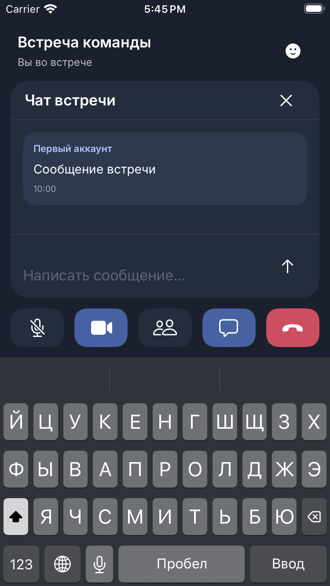
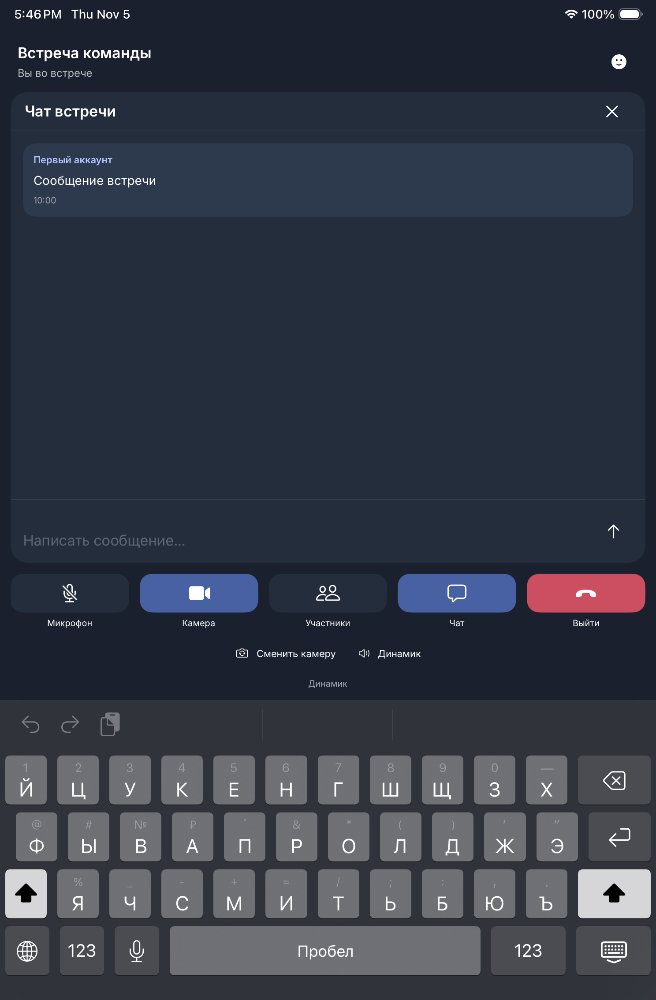

# Этап 04: WebRTC, SFU и видеоконференции

Дата: 2026-11-05. Реализация по `04_WEBRTC.md` в репозитории
`janickiy/meetspace_ios_mobile`, указанном пользователем. Backend не изменён.
Этап 05 не выполнялся.

Проверенный iOS source commit:
[`9676f3f67bb50db2c66bda1d9f1a77a60d14d024`](https://github.com/janickiy/meetspace_ios_mobile/commit/9676f3f67bb50db2c66bda1d9f1a77a60d14d024),
ветка `codex/stage04-webrtc`.
[CI run 42076699344](https://github.com/janickiy/meetspace_ios_mobile/actions/runs/42076699344):
все три jobs успешны. Package tests: 77 passed + 2 opt-in skipped; Release
Simulator build успешен. На iPhone и iPad — по 14 hosted/UI tests, без failures
и skips. Все 10 финальных снимков проверены; compact chat полностью виден
над composer при открытой клавиатуре. Физические устройства и deployment,
полная pixel parity и ручной VoiceOver отдельно отмечены **BLOCKED**.

## Источники и библиотека

| Источник | Зафиксированная версия | Использование |
| --- | --- | --- |
| backend `janickiy/meet-space` | `0bd1248a2411842515af4e02f1e95821616748fb` | REST, WS tickets, `media.*`, Pion SFU, права и гости |
| Android `janickiy/meet-space-android` | `b8f289983e60671d415a128734c2e5bb6e93a29d` | Последовательность сигнализации, публикации, состояния устройств |
| Макеты `janickiy/mobile_maket` | `04d6a8ecdac75ae568459bbed0f3f6647bf8cbb3` | Экран встречи, участники, чат, палитра и Inter |
| WebRTC Swift Package | `stasel/WebRTC`, exact `156.0.0`, commit `3cc466ea040e5dcd1344697bf211dc4c079d1a0c` | Нативный PeerConnection, захват и renderer |
| WebRTC upstream | `2a990ce0ccd00a3ad449f2201a8e5c2dad53177d`, `branch-heads/8078` | Исходная версия опубликованного binary artifact |

Backend runtime-код совпадает с исходным аудитом `56a0b07`; между pins изменён
README. Проверенный backend checkout остался чистым. Макеты существуют, поэтому
оговорка исходного задания о пустом репозитории к этой реализации не применяется.

SHA-256 загруженного `WebRTC-M156.xcframework.zip`:
`43c2a6f7a650185bbc911d7605a979589671886e8fc0ac283f54fdf3f511dc46`.
Лицензия WebRTC BSD-3-Clause, LICENSE/PATENTS/distribution LICENSE включены
в ресурсы модуля. У дистрибьютора есть device arm64 и simulator arm64/x86_64 slices.
Хэш, privacy manifest и ограничения лицензирования записаны в
[манифесте библиотеки](evidence/stage04/webrtc-library.json).
В приложение включены 39 дополнительных license/notice текстов: 34 лицензии
native dependencies и пять связанных notices. Они доступны через «Лицензии
компонентов» в профиле; источники и SHA-256 записаны в
[манифесте notices](evidence/stage04/webrtc-notices.json).
У дистрибьютора нет опубликованного точного GN dependency graph, поэтому
полнота notices относительно binary остаётся проверкой перед App Store.
Device framework поставляется unsigned, simulator — с ad-hoc подписью без
TeamIdentifier; archive signing, SDK distribution requirements и App Store
privacy labels не проверены этим этапом.

[Манифест исходников](evidence/stage04/source-manifest.json) фиксирует source
pins, SDK package/artifact, SHA-256 ключевых Swift-файлов, build/test inputs,
privacy manifest, harness и probe. Хэши рассчитаны по содержимому
проверенного source commit. CI использовал iPhone SE (3rd generation) и
iPad mini (A17 Pro), simulator runtime 26.2 (build 23C54), согласно xcresult
summary. Xcode 16.4 / SDK 18.5 — версия сборки, не simulator runtime.

`App/PrivacyInfo.xcprivacy` декларирует имя, email, user ID, сообщения,
фото/видео, аудиофайлы и другие пользовательские вложения как связанные с
пользователем данные для App Functionality, tracking=false. Это учитывает
сохраняемые account/chat/attachment данные выбранного пользователем сервера.
Live RTP сам по себе не означает запись встречи этим клиентом. App Store
labels и retention/policy конкретного deployment ещё не подтверждены.
Privacy manifest самого WebRTC SDK сохранён отдельно.

## Проверенные исправления

Objective-C callbacks PeerConnection/камеры явно `@Sendable`; camera capturer
создаётся после явного включения и permission/lifecycle checks. Два hosted
tests с настоящим SDK проходят на обеих платформах, включая ранее падавшие
paths. [Диагностика и подтверждение исправления](evidence/stage04/native-callback-crash.json).

Automatic library `MeetSpaceMedia` входит в app один раз через
`MeetSpaceFeatures`; hosted tests получают символы через app debug dylib /
`BUNDLE_LOADER`. Финальные сборки и native tests подтвердили эту схему.
Новый media engine получает новую renderer identity. Остановка media при
background не ждёт остановки chat WebSocket.

При открытой клавиатуре и доступной высоте менее 550 pt controls переходят
в компактное состояние, сохраняя touch targets не менее 44 pt. UI tests
проверяют, что sender/message находятся между heading и composer.
На финальных iPhone/iPad снимках имя отправителя, текст и время полностью
видны; clipping/overlap в десяти записанных состояниях не обнаружены.

## Реализованные компоненты

- `ConferenceRepository`: список/создание/статусы, приглашения, join/leave,
  участники/self, admission, moderation, media state, реакции, tickets,
  ICE configuration, сообщения/поиск/read state.
- `ConferenceInviteGateway`: публичное приглашение и guest join/resume.
  Гостевой bearer находится только в памяти и ограничен своим HTTPS-origin
  и conference ID; guest не использует account refresh/cookie.
- `ConferenceSignaling`: bounded envelopes и typed payloads, одноразовый
  WS ticket, subprotocol `go-recorder.v1`, проверка room/peer/request scope.
- `MeetSpaceMedia`: Unified Plan PeerConnection, Opus/VP8, STUN/TURN,
  камера/микрофон, переключение камеры, renderer, AVAudioSession voiceChat,
  Bluetooth route, interruptions и NWPathMonitor.
- `ConferenceSession` и `ConferenceWorkspace`: согласование offer/answer/ready,
  сериализация renegotiation, track catalog, media policy, reconnect,
  фон/возврат, локальное освобождение ресурсов.
- SwiftUI встреча использует отдельное состояние реальной конференции;
  тестовые media/socket doubles предназначены для проверок и превью.

Основные новые файлы находятся в
`Packages/MeetSpaceKit/Sources/{Core/Conference,API/ConferenceRepository,Realtime/ConferenceSignaling,Features/ConferenceSession,Features/ConferenceWorkspace}.swift`
и `Packages/MeetSpaceKit/Sources/Media/`.
Контрактные проверки находятся в `Packages/MeetSpaceKit/Tests/IntegrationTests/`;
настоящий SFU запускается через `scripts/run_webrtc_contract.py`,
его синтетический клиент — `scripts/fixtures/sfu_probe.go`.

[Полный список изменённых файлов](evidence/stage04/changed-files.txt)
получен командой `git diff --name-only 8bdb5f1..9676f3f` и фиксирует изменения
от исходного состояния этапа 03 до проверенного source commit.

| UI / интеграция | Файлы | Поведение |
| --- | --- | --- |
| Список и формы встреч | `Sources/Features/LiveMeetingsView.swift` | Создание, список, вход по приглашению, guest form |
| Экран конференции | `Sources/Features/LiveConferenceView.swift` | Prejoin/lobby/error, видеосетка, устройства, чат, реакции, участники и moderation |
| Показ и жизненный цикл | `Sources/Features/{ConferencePresentation,MeetSpaceRootView,AppModel,IdentityModel,WorkspaceView}.swift` | Представление звонка, смена account scope, scene/background и cleanup |
| Лицензии | `Sources/Features/LiveProfileView.swift`, `Sources/Media/Resources/` | Включённые LICENSE/PATENTS и third-party notices |
| iOS UI проверки | `App/UITestDependencies.swift`, `Tests/MeetSpaceUITests/FoundationUITests.swift` | DEBUG doubles; создание/контролы/чат/выход и отказ разрешения камеры |

`Sources/` в таблице относится к `Packages/MeetSpaceKit/`. UI doubles не
выдаются за физическую камеру или подключение iOS к настоящему SFU.

## Контракт и права

Используется текущий SFU-протокол `media.*`. Старые `webrtc.*` события
относятся к другому механизму relay и не подменяют SFU.

1. REST join создаёт/активирует membership; владелец новой встречи сначала
   имеет статус `left`. Для конференции и membership нужны отдельные переходы.
2. `POST /conferences/{id}/ws-ticket` выдаёт одноразовый ticket;
   подключение использует `/conferences/{id}/ws?ticket=…`.
   Access token не помещается в WS URL.
3. `conference.state` даёт connection ID и roster. Затем `media.join`
   возвращает mediaPeerId, maxPeers, worker ICE, capture limits и policy.
4. Клиент создаёт offer с публикациями, применяет answer, затем отправляет
   `media.ready`. SFU не пересылает RTP до ready.
5. `media.tracks`/`media.renegotiate` требуют нового offer без параллельных
   negotiation. ICE использует явный `candidate: null` для завершения.
6. Новый WS/peer получает новые IDs; REST media state использует sequence
   своей connection. UUID wire-строки отправляются lowercase.

Backend допускает maxPeers 2…32, default 10; предел не зашит как 16 участников.
Поддерживаемые SFU кодеки — Opus 48 kHz stereo и VP8. Публикация simulcast
и других кодеков этим этапом не добавляется. Дорожки экрана могут приниматься;
публикация экрана iOS не входит в этап 04.

Запрет камеры/микрофона требует убрать публикацию и отправляющее направление
transceiver. Одного `track.enabled = false` недостаточно: SFU отклоняет
запрещённую публикацию. Снятие запрета не включает устройство без действия
пользователя. После reconnect/background capture также остаётся выключенным.

Owner может управлять разрешёнными действиями над другим участником;
co_host — только mute/screen/kick над обычным participant. Самоуправление
и moderation owner запрещены. UI не заменяет серверную авторизацию.
Фактическая роль нового guest — `participant`; guest scope определяется
JWT/user `guestConferenceId`, а не выдуманной ролью `guest`.
Действительное приглашение допускает немедленный вход через waiting room.
Admission не навязывается локально в обход фактического ответа API.

`GET /webrtc/config` предоставляет iceTransportPolicy и expiry временного TURN.
`media.joined` предоставляет ICE конкретного worker; API controller не
прокидывает туда policy/expiry. Клиент использует и валидирует worker ICE
из joined, объединяя его с REST policy/expiry; REST ICE служит fallback,
если поле отсутствует. Отдельный `MEDIA_ICE_SERVERS_JSON` не теряется.

## Проверки и их границы

| Критерий | Статус | Фактическое доказательство / граница |
| --- | --- | --- |
| REST конференций, guest scope, роли | PASS | Swift-клиент против настоящего pinned API: create/start/join, guest, 403 moderation, leave/rejoin/finish |
| Чат конференции и реакции | PASS | Настоящий API: idempotency, reply/edit/search/read/delete, guest message, допустимые реакции |
| Локальные package tests проверенного source commit | PASS | 77 passed + 2 opt-in skipped, 0 failures; свежий `host-tests.txt` |
| Package tests проверенного source commit в CI | PASS | Run 42076699344: 77 passed + 2 opt-in skipped, всего 79 |
| SFU offer/answer/ready и RTP | PASS для синтетических клиентов | Два Pion клиента, двусторонние Opus/VP8 RTP, три цикла; по две negotiation на peer в каждом цикле |
| Серверное соблюдение media policy | PASS | Публикация камеры после блокировки модератором отклонена настоящим SFU |
| SFU cleanup | PASS | После закрытия rooms/peers/tracks/subscriptions = 0, peer failures = 0 |
| Нативный WebRTC binary | PASS в host probe | 10 create/offer/close циклов M156, SDP msid/track IDs, Opus/VP8, закрытый peer отклоняет offer |
| Полный native adapter typecheck | PASS для проверенного снимка | Mac Catalyst slice M156 и Apple UIKit/AVFoundation headers; это не runtime iOS test |
| Lifecycle review и workspace regressions | PASS для проверенных сценариев | Замечания исправлены; 7 дополнительных тестов задержанных leave/join, повторного dismiss/create, scheduled owner invitation и guest callback после restore |
| Release iOS build проверенного source commit | PASS | Job 127418691057: `BUILD SUCCEEDED`, generic iOS Simulator |
| iOS hosted media и iPhone/iPad UI | PASS | По 14 tests: 3 hosted (2 actual SDK + 1 Keychain), 11 UI; 0 failures/skips на каждой платформе |
| iOS ↔ Web/Android двусторонние аудио/видео | BLOCKED для device acceptance | Нужны физические устройства, signing и доступный HTTPS/WSS deployment |
| Камера, микрофон, Bluetooth, interruption, Wi-Fi↔LTE | BLOCKED для device acceptance | Host probe и synthetic RTP не проверяют физический захват/маршрутизацию |
| TURN relay / production TLS | BLOCKED для deployment acceptance | Проверенный harness использовал direct Docker network; relayConnections = 0 |
| UI записанных сценариев | PASS | 10 финальных снимков проверены, compact-chat geometry assertions проходят на iPhone/iPad |
| Полное соответствие макетам и ручной VoiceOver | BLOCKED | Визуальная проверка записанных состояний не является полной pixel-parity/accessibility приёмкой |

PASS относится только к указанному сценарию. Синтетические RTP payloads служат
проверке передачи пакетов; они не подтверждают декодированное качество
звука/изображения, физический захват или взаимодействие настоящего iOS клиента
с Web/Android.

В успешно завершившемся полном прогоне SFU переслал 1286 RTP packets,
11277 bytes, без dropped packets. После проверки:
`roomsActive=0`, `mediaPeersActive=0`, `tracksPublished=0`,
`subscriptions=0`, `peerConnectionTotal=7`,
`peerConnectionFailures=0`, `directConnections=6`, `relayConnections=0`.
Первый медиасеанс длился более шести секунд, то есть дольше WS pong deadline 4s.
Контейнеры, volumes и network этого запуска удалены.

Сохранённые доказательства:

- [Полный журнал host tests](evidence/stage04/host-tests.txt): текущий `9676f3f`, 77 passed + 2 opt-in skipped; отредактирован один синтетический URL-аргумент с тестовыми credentials, результаты не изменены.
- [Настоящий Swift REST contract](evidence/stage04/contract.log).
- [SFU policy/RTP cycles](evidence/stage04/sfu-probe.log) и
  [нулевые итоговые media metrics](evidence/stage04/sfu-cleanup.json).
- [Pinned backend и образы runtime](evidence/stage04/runtime.json).
- [Нативный WebRTC host probe](evidence/stage04/native-peer-host-probe.txt).
- [CI receipt](evidence/stage04/ci-run.json) и [package/Release results](evidence/stage04/package-results.txt).
- [iPhone summary](evidence/stage04/iPhone-summary.json) / [results](evidence/stage04/iPhone-results.txt);
  [iPad summary](evidence/stage04/iPad-summary.json) / [results](evidence/stage04/iPad-results.txt).
- [Галерея снимков](evidence/stage04/screenshots/) и [манифест с SHA-256](evidence/stage04/screenshots.json).
- [Исходный native callback crash и исправление](evidence/stage04/native-callback-crash.json).

Отдельный локальный журнал последних workspace regressions:
`/tmp/meetspace-stage04-workspace-tests.log` — 7 tests, 0 failures, 0.059s;
эти тесты также входят в успешный финальный CI package run 42076699344.
Private service logs не публикуются.

## Нативные снимки

По пять состояний на каждую платформу; источник — финальный CI source commit.
UI использует DEBUG doubles, поэтому видеоплитки и отказ разрешения здесь
не являются физическим capture или реальным SFU-сеансом.

| Состояние | iPhone SE (3rd generation) | iPad mini (A17 Pro) |
| --- | --- | --- |
| Перед входом | [iPhone](evidence/stage04/screenshots/iPhone-stage04-prejoin.png) | [iPad](evidence/stage04/screenshots/iPad-stage04-prejoin.png) |
| Подключение и controls | [iPhone](evidence/stage04/screenshots/iPhone-stage04-connected.png) | [iPad](evidence/stage04/screenshots/iPad-stage04-connected.png) |
| Участники | [iPhone](evidence/stage04/screenshots/iPhone-stage04-participants.png) | [iPad](evidence/stage04/screenshots/iPad-stage04-participants.png) |
| Чат и клавиатура | [iPhone](evidence/stage04/screenshots/iPhone-stage04-meeting-chat.png) | [iPad](evidence/stage04/screenshots/iPad-stage04-meeting-chat.png) |
| Отказ камеры | [iPhone](evidence/stage04/screenshots/iPhone-stage04-camera-permission-denied.png) | [iPad](evidence/stage04/screenshots/iPad-stage04-camera-permission-denied.png) |

Чат на компактном iPhone и на iPad:





## Фактические команды

На этом host установлены Command Line Tools, полного Xcode нет:

```sh
SDKROOT=/Library/Developer/CommandLineTools/SDKs/MacOSX26.4.sdk \
swift test --package-path Packages/MeetSpaceKit \
  --sdk /Library/Developer/CommandLineTools/SDKs/MacOSX26.4.sdk \
  -Xswiftc -load-plugin-library \
  -Xswiftc /Library/Developer/CommandLineTools/usr/lib/swift/host/plugins/testing/libTestingMacros.dylib
python3 scripts/run_webrtc_contract.py \
  --backend /tmp/meetspace-ios-stage03/backend \
  --output /tmp/meetspace-stage04-contract-03
git diff --check
```

Полный host запуск текущего `9676f3f`: 77 passed + 2 opt-in skipped,
0 failures. Финальный CI run 42076699344 и визуальная проверка compact chat
также успешны.
Настоящий Swift REST contract:
1 test, 0 failures, 0.294s; затем PASS policy probe и три SFU media cycles.
Пропущенный обычным Swift run conference backend test выполнен отдельно
этим harness. Stage 03 backend opt-in имеет доказательство в отчёте этапа 03.

В успешном package/Release CI job проверенного `9676f3f` выполнены:

```sh
swift test --package-path Packages/MeetSpaceKit
xcodebuild -project MeetSpace.xcodeproj -scheme MeetSpace-Release \
  -configuration Release -destination 'generic/platform=iOS Simulator' \
  CODE_SIGNING_ALLOWED=NO build
python3 scripts/ci_simulators.py --family iPhone
python3 scripts/ci_simulators.py --family iPad
```

Дополнительно с теми же SDK/plugin аргументами выполнен filter
`IntegrationTests\.(conferenceWorkspace|conferenceGuestLate)`.
Проверены два последовательных dismiss при задержанном REST leave, запрет
создания поверх действующего звонка, компенсационный leave после закрытия
workspace во время join, запрет позднего start после закрытия, запуск owner
по scheduled invite, неподтверждённый выход и поздний guest POST после restore.
Если сервер не подтвердил выход, локальная камера/микрофон уже закрыты;
busy заканчивается, показывается ошибка, повторное использование этого workspace
остаётся запрещено. Поздний успешный callback после deadline не снимает запрет.

Harness проверяет точный backend pin и отсутствие изменений его tracked sources.
Собирает unmodified API/media-worker и отдельный test-only Go/Pion клиент,
запускает свои Postgres/Redis/MinIO/RabbitMQ/API/SFU в отдельной Docker network.
На host доступны только случайные loopback ports. Секреты/временные аккаунты
создаются для этого запуска; bearer tokens хранятся в памяти. Ни данные
пользовательских сервисов, ни production credentials не используются.

На другом host сначала нужен образ MinIO из pinned backend:

```sh
docker build -f /path/to/backend/dockers/minio/Dockerfile \
  -t go-recorder-minio:local /path/to/backend
python3 scripts/run_webrtc_contract.py --backend /path/to/backend
```

Опция `--skip-swift` запускает только SFU probe и явно помечает Swift contract
SKIPPED. Для опубликованного полного результата эта опция не использовалась.
Тестовый HTTP/WS loopback adapter не входит в приложение. Production transport
требует HTTPS/WSS с системной TLS-проверкой; ATS bypass не добавлялся.

## Оставшаяся приёмка

CI и визуальная проверка записанных состояний завершены. Для device acceptance
нужны физические iPhone/iPad и тестовый HTTPS/WSS сервер:

| Проверка на устройстве | Статус | Критерий снятия блокировки |
| --- | --- | --- |
| iOS ↔ Web и Android | BLOCKED | Двусторонние слышимые аудио и декодированное видео минимум 5 минут для обеих пар, зафиксированы версии клиентов и устройств |
| Permissions и prejoin | BLOCKED | До явного включения нет capture; отказ/отзыв камеры или микрофона показан корректно, разрешённое устройство остаётся управляемым |
| Moderation | BLOCKED | Запрещённая камера/микрофон прекращает capture и публикацию; участник не обходит запрет, снятие запрета не включает устройство само |
| 10 join/leave циклов | BLOCKED | После каждого выхода нет активной camera capture session, аудиозахвата, renderer и media peer; системные индикаторы выключены |
| Bluetooth и interruptions | BLOCKED | Подключение/отключение гарнитуры и прерывание корректно меняют маршрут; после прерывания capture возобновляется только явно |
| Wi-Fi↔LTE, reconnect, TURN | BLOCKED | Переходы сети восстанавливают связь с новым peer; принудительный relay подтверждён selected candidate pair, capture не включается автоматически |
| Background/foreground | BLOCKED | Уход в фон своевременно останавливает захват независимо от чата; после возврата камера/микрофон выключены до действия пользователя |

Нулевые метрики SFU и host PeerConnection cleanup не заменяют эти проверки.

Запись, push, CallKit, screen broadcast extension и App Store distribution
не заявляются результатом этапа 04.
