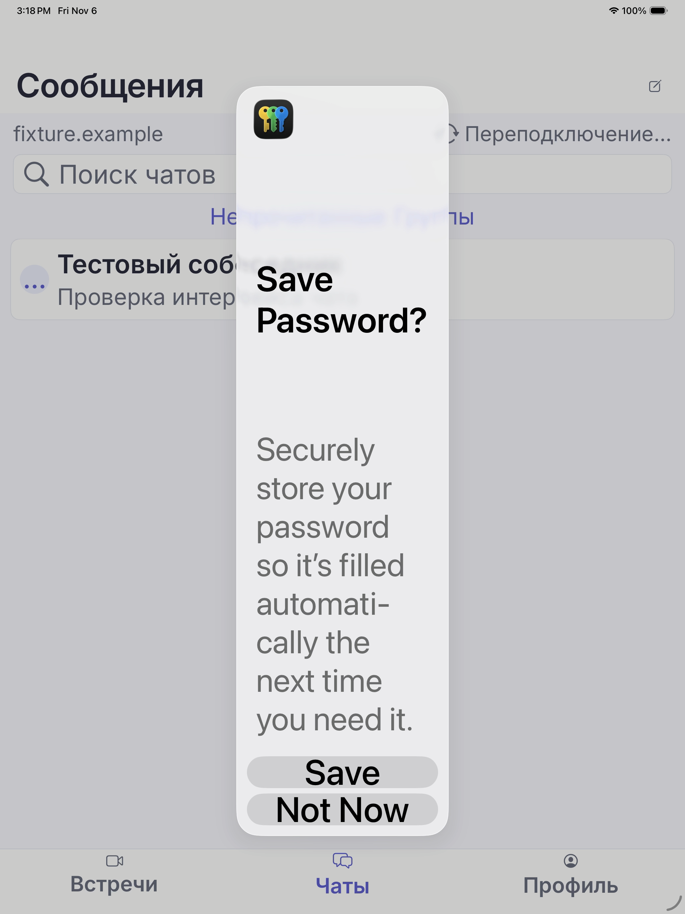

# iPad26: contrast findings и двухстрочный Passwords title

Проверено 2026-11-06 по artifacts [CI3 42240106296](https://github.com/janickiy/meetspace_ios_mobile/actions/runs/42240106296), source `586bfe875355f930a5d463214bd7860a78ac189e`. Устройство — iPad Pro 13-inch (M5), simulator iPadOS 26.2, Xcode 26.3 (17C529); [environment](evidence/accessibility-attempt03/iPad26-contrast-environment.json). Это расследование **провалившегося аудита**, не новый CI PASS и не заключение о соответствии WCAG.

## Исходные данные и метод

[Manifest](evidence/accessibility-attempt03/iPad26-contrast-manifest.json) содержит original exported filenames и SHA-256. Семь PNG скопированы **байт в байт** из XCTest attachments, без изменения размера, цвета, обрезания или ретуши. Все имеют 2064×2752 pixels и профиль sRGB IEC61966-2.1. Они просмотрены целиком через `view_image`.

[Raw findings](evidence/accessibility-attempt03/iPad26-contrast-raw-issues.json) также сохранены без изменений: 30 записей, из них 17 contrast findings, включая четыре повторных status findings из `recordings-footer`. В исходном результате 16 contrast findings имеют `unresolved`, один — ранее reviewed декоративный `ТЕ`. Ни одна raw запись этим исследованием не удалена и не переименована в PASS.

[Скрипт](evidence/accessibility-attempt03/ipad26-contrast-pixels.swift) повторно проверяет SHA-256 PNG, переводит raw frame из points в pixels с коэффициентом 2 и считает цвета в целой области `floor(min)…ceil(max)`. [Полученный JSON](evidence/accessibility-attempt03/iPad26-contrast-pixels.json) сохраняет raw index, ID/label, frame, counts, наиболее частые цвета и контраст наблюдаемой пары foreground/background. Для core используются реально присутствующие в PNG цвета, а не только значения из Swift source. Дополнительное преобразование цветового пространства не выполняется: PNG уже sRGB.

Контраст рассчитан по относительной luminance sRGB: `(Lmax + 0.05) / (Lmin + 0.05)`. Это **не воспроизведение закрытого алгоритма Apple**. Краевые antialiased pixels неизбежно светлее ядер букв; JSON не объявляет их все пикселями с contrast ≥4.5. Проверка cores, полноты видимого текста и отсутствия перекрытия — отдельные свидетельства. Они не устанавливают причину Apple finding: версия про antialiasing, тонкие шрифты, округление или особенности UIKit/SwiftUI остаётся неподтверждённой.

Воспроизведение на macOS:

```sh
swift docs/stage08/evidence/accessibility-attempt03/ipad26-contrast-pixels.swift > /tmp/ipad26-contrast-pixels.json
swift docs/stage08/evidence/accessibility-attempt03/ipad26-password-ocr.swift > /tmp/ipad26-password-ocr.json
```

## Полностью видимые тексты

В таблице frame — исходные `(x, y, width, height)` в points. `—` означает **пустой identifier в raw**, а не разрешение сопоставлять любой элемент без ID. `Core pixels` — число пикселей точного foreground в этом frame. Все перечисленные строки на соответствующих PNG полностью читаются и не находятся за tab bar.

| Screen / ID | Label | Raw frame, pt | Наблюдаемые fg / bg | Core ratio / pixels |
| --- | --- | --- | --- | --- |
| welcome / — | Создать пространство на своём VPS | `(623,459.5,200.5,13.5)` | `#686c7d / #ffffff` | 5.2112 / 699 |
| calendar / — | На этой неделе | `(794.25,395,83.5,13.5)` | `#686c7d / #ffffff` | 5.2112 / 285 |
| calendar / `calendar.weekday.0` | Пн | `(49.25,391.25,13.5,12.5)` | `#292b3b / #ffffff` | 13.9722 / 53 |
| calendar / `calendar.weekday.4` | Пт | `(285.75,391.25,12.5,12.5)` | `#ffffff / #5d5fcd` | 5.2713 / 47 |
| recordings / `recording.status.77777777-7777-4777-8777-777777777771` | Готова | `(146,369.5,36.5,13.5)` | `#5d5fcd / #ffffff` | 5.2713 / 133 |
| recordings / `recording.status.77777777-7777-4777-8777-777777777772` | Обрабатывается | `(146,481.5,90.5,13.5)` | `#686c7d / #ffffff` | 5.2112 / 355 |
| recordings / `recording.status.77777777-7777-4777-8777-777777777773` | Не удалось записать | `(146,593.5,113.5,13.5)` | `#686c7d / #ffffff` | 5.2112 / 408 |
| recordings / `recording.status.77777777-7777-4777-8777-777777777774` | Готова | `(146,705.5,36.5,13.5)` | `#5d5fcd / #ffffff` | 5.2713 / 133 |
| folders / `folders.subtitle` | Личное пространство | `(20,106,121.5,13.5)` | `#5d5fcd / #f7f8fc` | 4.9669 / 719 |

Original PNG: [welcome](evidence/accessibility-attempt03/screenshots/iPad26-stage08-accessibility-welcome.png), [calendar](evidence/accessibility-attempt03/screenshots/iPad26-stage08-accessibility-calendar.png), [recordings](evidence/accessibility-attempt03/screenshots/iPad26-stage08-accessibility-recordings.png), [folders](evidence/accessibility-attempt03/screenshots/iPad26-stage08-accessibility-folders.png).

Четыре status findings повторяются с теми же IDs, frames и core ratios на [recordings-footer PNG](evidence/accessibility-attempt03/screenshots/iPad26-stage08-accessibility-recordings-footer.png). На iPad весь retention notice уже виден, поэтому frame карточек в этом повторном проходе не изменился. Это четыре повторных наблюдения, не четыре новых проверенных состояния. Отложенное решение по footer не используется для оправдания этих status findings.

Фактические цвета ядер совпадают с непрозрачной палитрой приложения; дополнительное снижение opacity у перечисленных букв в этих PNG не обнаружено. Само такое совпадение **не является blanket разрешением на contrast exceptions**: узкий reviewed case должен сохранять screen, конкретный ID либо однозначный label/контейнер, issue type и связь с этими artifacts. Другие даты, статусы, строки календаря, цвета, устройства и layout revisions здесь не измерены.

## Отдельные composite, decorative и disabled случаи

| Screen / ID / label | Raw frame, pt | Измерение | Интерпретация |
| --- | --- | --- | --- |
| messages / — / «Выберите чат» | `(611.75,641,149,98.75)` | Text `#292b3b` на `#f7f8fc`: 13.1654, 3154 core pixels. System icon `#90919b` на том же фоне: 2.9492, 3256 pixels. | [PNG](evidence/accessibility-attempt03/screenshots/iPad26-stage08-accessibility-messages.png) показывает, что raw frame содержит **иконку и текст вместе**. Высокий контраст текста не доказывает высокий контраст всей composite области. Для декоративной иконки нужно отдельное обоснование либо явное улучшение её цвета; не называть весь frame normal-text PASS. |
| messages / — / «ТЕ» | `(30,317.5,44,44)` | `#5d5fcd / #eeeffe`: 4.6219, 154 core pixels | Декоративные инициалы дублируют полное доступное имя конкретной conversation row. Это прежний отдельный reviewed case, не исключение любого avatar. |
| settings / — / «ПЕ» | `(56,142,40,40)` | `#5d5fcd / #eeeffe`: 4.6219, 168 core pixels | [PNG](evidence/accessibility-attempt03/screenshots/iPad26-stage08-accessibility-settings.png): маленький sidebar avatar рядом с полным именем «Первый аккаунт». Размер 40×40 отличается от messages avatar; нужен отдельный контейнерный guard. |
| settings / `saveProfile` / «Сохранить профиль» | `(334,507,650,44)` | Наблюдаемый текст `#d5d5f2` на `#b2b3e7`: **1.3939**, 1427 foreground pixels | Это действительно низкий контраст **неактивной** кнопки. Имя не изменено, `SettingsModel.canSaveProfile == false`; `MSButtonStyle` применяет opacity 0.45. Reviewed decision для этого состояния должен проверять `isEnabled == false`; его нельзя переносить на активную кнопку. |

## Save Password: фактическая причина срыва UI flow

`testAccessibilityStage08LargeTextLiveFlow` дошёл до workspace, но системное окно Passwords осталось поверх него. В [CI log excerpt](evidence/accessibility-attempt03/iPad26-password-login-log.txt) на t≈47.67–48.33 проверка ещё не нашла alert через AX, затем синхронный Vision занял около 14 секунд. Когда управление вернулось, 12-секундный deadline уже закончился. Финальная проверка на t≈62.35 впервые нашла `Save Password?` и hittable `Not Now`, но код только выполнил `XCTAssertFalse`: нажатия после этого обнаружения не было. Это дефект ожидания/повторного опроса harness, не ошибка авторизации приложения.



Этот PNG — **производный кадр видео**, а не переименованный XCTest screenshot. Original MP4 `1DCA4F3D-DB04-44C4-943F-1DB9F0B77A91.mp4` из `results-iPad26/iPad26-screenshots`, SHA-256 и параметры извлечения записаны в manifest. Запрошено 62.125 s при zero tolerance; AVAssetImageGenerator сообщил actual time 60.3166667 s. Повторное извлечение [скриптом](evidence/accessibility-attempt03/ipad26-password-frame.swift) дало байт в байт тот же PNG. Ретушь/масштабирование/обрезание не применялись; большой MP4 не дублируется в Git.

Дополнительная причина несрабатывания OCR fallback: AX5 переносит title на две строки. [Результат Vision](evidence/accessibility-attempt03/iPad26-password-ocr.json) получен локально на macOS 27.0.1, request `accurate`, `en-US`, `usesLanguageCorrection=false`, без async completion handler. Это реальное повторное распознавание сохранённого кадра, **не результат новой проверки на iOS**.

| Observation | Confidence | Normalized bbox `(x,y,w,h)`, origin bottom-left |
| --- | --- | --- |
| Save — верхняя строка title | 1.0 | `(0.374031,0.678779,0.112403,0.029070)` |
| Password? — вторая строка title | 1.0 | `(0.372116,0.624587,0.255769,0.038326)` |
| Save — нижняя системная кнопка | 1.0 | `(0.427406,0.136870,0.129670,0.031311)` |
| Not Now | 1.0 | `(0.403101,0.097384,0.193798,0.030523)` |

Ни одной отдельной observation с normalized `savepassword` нет. В тексте описания также есть отдельное слово `password`; произвольно объединять все `Save`/`password` нельзя. Узкий двухстрочный match требует уверенные соседние строки, одинаковый левый край, `Save` непосредственно над `Password?`, затем decline ниже title. На данном кадре разница левых краёв title ≈0.00192, межстрочный gap ≈0.01587. Нижняя кнопка Save этим условиям не соответствует. Центр наблюдаемого `Not Now` в top-left normalized coordinates: **`(0.500000,0.887355)`**. Это координаты этого кадра, а не константа для будущих tap: harness должен вычислять их из текущего screenshot.

Минимальная исправляемая граница ожидания — повторный AX lookup после медленного OCR и bounded нажатие найденной decline-кнопки перед итоговым assert. Двухстрочный OCR guard нужен как fallback, когда AX снова не содержит remote window. Production Password AutoFill при этом не меняется. В этом исследовании UI/test исходники не редактировались; будущий handler и новый CI требуют собственной проверки.

## Предел вывода

Этот отчёт дополняет [общий review](ACCESSIBILITY_REVIEW.md), [iPad AX5 review](ACCESSIBILITY_IPAD_REVIEW.md) и [политику исключений](ACCESSIBILITY_POLICY.md). Причина расхождения Apple contrast audit с измеренными cores **не установлена**. Reviewed exceptions допустимо привязывать только к конкретным подтверждённым cases, сохраняя raw; неизвестные findings должны оставаться FAIL. Ни один результат этого документа не закрывает VoiceOver/device review, все состояния интерфейса или общий WCAG conformance.
